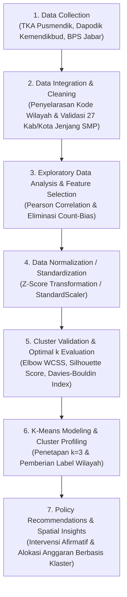

# Klasterisasi Wilayah Pendidikan SMP Jawa Barat Menggunakan K-Means Clustering
> **Analisis Disparitas Mutu Capaian TKA, Kebutuhan Sarana Prasarana, dan Konteks Sosio-Ekonomi di 27 Kabupaten/Kota Jawa Barat**

---

## Daftar Isi
1. [Latar Belakang & Tujuan](#1-latar-belakang--tujuan)
2. [Alur Kerja Data Mining (Pipeline)](#2-alur-kerja-data-mining-pipeline)
3. [Tahap 1: Pengumpulan & Sumber Data](#tahap-1-pengumpulan--sumber-data)
4. [Tahap 2: Integrasi & Pembersihan Data](#tahap-2-integrasi--pembersihan-data)
5. [Tahap 3: Analisis Eksploratif (EDA) & Multikolinearitas](#tahap-3-analisis-eksploratif-eda--multikolinearitas)
6. [Tahap 4: Seleksi Fitur & Standardisasi Data](#tahap-4-seleksi-fitur--standardisasi-data)
7. [Tahap 5: Evaluasi Penentuan Jumlah Klaster Optimal (k)](#tahap-5-evaluasi-penentuan-jumlah-klaster-optimal-k)
8. [Tahap 6: Eksekusi K-Means Clustering & Profiling Wilayah](#tahap-6-eksekusi-k-means-clustering--profiling-wilayah)
9. [Rekomendasi Kebijakan Berbasis Data (Policy Action)](#9-rekomendasi-kebijakan-berbasis-data-policy-action)
10. [Struktur Direktori Proyek](#10-struktur-direktori-proyek)
11. [Panduan Menjalankan Skrip](#11-panduan-menjalankan-skrip)

---

## 1. Latar Belakang & Tujuan

Pemerataan kualitas pendidikan jenjang Sekolah Menengah Pertama (SMP) di Provinsi Jawa Barat menghadapi tantangan multidimensi. Disparitas mutu hasil belajar siswa tidak hanya dipengaruhi oleh faktor internal proses belajar mengajar, melainkan berkaitan erat dengan:
1. **Daya tampung sarana fisik dan kecukupan tenaga pendidik**.
2. **Kondisi kesejahteraan sosio-ekonomi keluarga siswa di wilayah tersebut**.

Proyek data mining ini bertujuan untuk:
* Mengidentifikasi pola disparitas pendidikan di 27 kabupaten/kota Jawa Barat secara objektif dan matematis.
* Mengelompokkan wilayah ke dalam klaster profil yang jelas dan interpretatif (*Wilayah Maju*, *Wilayah Darurat Sarana Prasarana*, dan *Wilayah Rentan dan Terpencil*).
* Memberikan landasan rekomendasi kebijakan (*evidence-based policy*) yang tepat sasaran bagi pemerintah daerah dan pemangku kepentingan pendidikan.

---

## 2. Alur Kerja Data Mining (Pipeline)

Proses data mining dilakukan mengacu pada metodologi baku CRISP-DM (*Cross-Industry Standard Process for Data Mining*):



---

## Tahap 1: Pengumpulan & Sumber Data

Dataset dikumpulkan dari tiga domain data primer:
1. **Domain Capaian Akademik**:
   * Data nilai rerata Tes Kemampuan Akademik (TKA) jenjang SMP bidang Matematika (`tka_rerata_mtk`) dan Bahasa Indonesia (`tka_rerata_bind`) yang diperoleh dari hasil *web scraping* resmi.
2. **Domain Infrastruktur & SDM Pendidikan (Dapodik Kemendikbud)**:
   * Jumlah sekolah SMP (negeri dan swasta).
   * Jumlah guru dan tenaga kependidikan (TKP).
   * Jumlah murid terdaftar.
3. **Domain Sosio-Ekonomi Daerah (BPS Jawa Barat)**:
   * Persentase penduduk miskin per kabupaten/kota (`pct_penduduk_miskin`).
   * Garis kemiskinan (Rp/kapita/bulan).
4. **Domain Spasial**:
   * Peta batas administrasi 27 kabupaten/kota Provinsi Jawa Barat dalam format GeoJSON.

---

## Tahap 2: Integrasi & Pembersihan Data

* **Penyelarasan Entitas**: Penggabungan multi-sumber data dilakukan menggunakan pencocokan ganda: `kode_wilayah` (Kemendagri), `kode_bps`, dan nama kabupaten/kota resmi Jawa Barat.
* **Filter Jenjang**: Difokuskan spesifik pada jenjang SMP di seluruh 27 kabupaten/kota (18 kabupaten dan 9 kota).
* **Validasi Kualitas Data**: Dilakukan pengecekan *missing value* ($0$ nilai kosong ditemukan) dan penyeragaman tipe data ke format floating-point numerik.
* **Output Tahap Ini**: Disimpan dalam file [`dataset/jabar_smp_merged.csv`](file:///dataset/jabar_smp_merged.csv) dan [`dataset/dataset_final_smp.csv`](file:///dataset/dataset_final_smp.csv).

---

## Tahap 3: Analisis Eksploratif (EDA) & Multikolinearitas

Analisis korelasi dijalankan melalui skrip [`clustering/statistik_grafik/korelasi.py`](file:///clustering/statistik_grafik/korelasi.py) menggunakan koefisien korelasi Pearson:

$$r_{xy} = \frac{\sum_{i=1}^{n} (x_i - \bar{x})(y_i - \bar{y})}{\sqrt{\sum_{i=1}^{n} (x_i - \bar{x})^2} \sqrt{\sum_{i=1}^{n} (y_i - \bar{y})^2}}$$

### Alasan Pengambilan Keputusan (Eliminasi *Count-Bias*):
1. **Masalah Variabel Agregat Mentah**:
   * Ditemukan multikolinearitas ekstrem pada variabel jumlah absolut:
     * `guru_total` vs `murid_total` ($r = 0.987$)
     * `sekolah_total` vs `guru_total` ($r = 0.955$)
     * `sekolah_total` vs `murid_total` ($r = 0.950$)
   * *Alasan Keputusan*: Jumlah absolut sangat bias terhadap luas geografis dan jumlah penduduk kabupaten (misal Kabupaten Bogor berpenduduk 5+ juta jiwa vs Kota Cirebon berpenduduk 300 ribu jiwa). Jika dimasukkan ke klasterisasi, algoritma hanya akan mengelompokkan wilayah berdasarkan ukuran daerah (*size-bias*), bukan mutu pendidikannya.
2. **Solusi Perhitungan Rasio**:
   * Dihitung variabel intensif:
     * **Rasio Murid per Guru**: $\text{Rasio M/G} = \frac{\text{murid\_total}}{\text{guru\_total}}$ (mengukur beban pengajaran guru).
     * **Rasio Murid per Sekolah**: $\text{Rasio M/S} = \frac{\text{murid\_total}}{\text{sekolah\_total}}$ (mengukur skala dan kepadatan gedung sekolah).
3. **Temuan Korelasi Akademik & Kemiskinan**:
   * Korelasi `tka_rerata_bind` dan `tka_rerata_mtk` sebesar **$0.978$** (hampir sempurna).
   * Korelasi antara skor TKA dengan `pct_penduduk_miskin` bernilai negatif kuat ($r = -0.62$ s/d $-0.65$), membuktikan bahwa kondisi ekonomi daerah berpengaruh signifikan terhadap capaian akademik siswa.

---

## Tahap 4: Seleksi Fitur & Standardisasi Data

Dijalankan melalui skrip [`clustering/standarisasi.py`](file:///clustering/standarisasi.py).

### 1. Lima Fitur Terpilih
Dipilih 5 fitur yang mewakili 3 pilar penentu:
* **Pilar Mutu Akademik**: `tka_rerata_mtk` dan `tka_rerata_bind`.
* **Pilar Kapasitas SDM & Sarpras**: `rasio_murid_guru` dan `rasio_murid_sekolah`.
* **Pilar Konteks Sosio-Ekonomi**: `pct_penduduk_miskin`.

### 2. Rumus Standardisasi (Z-Score Normalization)
Algoritma K-Means mengukur kemiripan antar-daerah menggunakan **jarak Euclidean**:

$$d(p, q) = \sqrt{\sum_{j=1}^{d} (p_j - q_j)^2}$$

Karena satuan masing-masing fitur sangat berbeda (rasio murid per sekolah bernilai $200 - 450$, sedangkan kemiskinan bernilai $2\% - 11\%$, dan nilai TKA berkisar $37 - 72$), fitur dengan angka ratusan akan mendominasi perhitungan jarak. Oleh karena itu, seluruh fitur ditransformasikan ke skala Z-Score:

$$z = \frac{x - \mu}{\sigma}$$

Di mana:
* $\mu = \frac{1}{N}\sum_{i=1}^{N} x_i$ (Rata-rata fitur)
* $\sigma = \sqrt{\frac{1}{N}\sum_{i=1}^{N} (x_i - \mu)^2}$ (Standar deviasi fitur)

Setelah transformasi: $\mu = 0$ dan $\sigma = 1$ untuk seluruh fitur.
* **Output**: Disimpan di [`dataset/fitur_kmeans_smp_standardisasi.csv`](file:///dataset/fitur_kmeans_smp_standardisasi.csv).

---

## Tahap 5: Evaluasi Penentuan Jumlah Klaster Optimal ($k$)

Dijalankan melalui skrip [`clustering/evaluasi_k.py`](file:///clustering/evaluasi_k.py). Pengujian dilakukan untuk rentang $k = 2$ hingga $k = 8$.

### Tiga Metrik Pengujian:

#### 1. Elbow Method (Within-Cluster Sum of Squares / WCSS)
Mengukur total variansi kuadrat jarak titik data ke pusat klasternya:

$$\text{WCSS} = \sum_{k=1}^{K} \sum_{x \in C_k} ||x - \mu_k||^2$$

#### 2. Silhouette Coefficient
Mengukur seberapa dekat suatu titik dengan klasternya sendiri dibandingkan dengan klaster terdekat lainnya:

$$s(i) = \frac{b(i) - a(i)}{\max(a(i), b(i))}$$

Di mana $a(i)$ adalah rata-rata jarak ke sesama anggota klaster, dan $b(i)$ adalah rata-rata jarak ke anggota klaster terdekat berikutnya. Nilai berkisar antara $-1 \le s(i) \le 1$ (makin mendekati 1 makin optimal).

#### 3. Davies-Bouldin Index (DBI)
Mengukur rasio penyebaran internal klaster terhadap pemisahan antarklaster:

$$DB = \frac{1}{k}\sum_{i=1}^{k} \max_{j \neq i} \left( \frac{\bar{d}_i + \bar{d}_j}{d(c_i, c_j)} \right)$$

Nilai semakin kecil mendekati $0$ menunjukkan klaster yang semakin terpisah dengan baik (*well-separated*).

### Tabel Hasil Evaluasi Metrik:
| $k$ (Jumlah Klaster) | WCSS / Inertia *(Elbow)* | Silhouette Score | Davies-Bouldin Index | Calinski-Harabasz |
| :---: | :---: | :---: | :---: | :---: |
| **2** | 78.35 | 0.3481 | 1.1191 | 18.08 |
| **3** | **56.26** *(Siku Penurunan)* | **0.3270** | **0.9905** *(Drop < 1.0)* | 16.80 |
| **4** | 42.15 | 0.3155 | 1.0266 | 16.89 |
| **5** | 34.16 | 0.3426 | 0.8911 | 16.24 |
| **6** | 28.37 | 0.3305 | 0.8196 | 15.79 |

### Alasan Keputusan Memilih $k = 3$:
1. **Titik Siku Pertama (*Elbow Point*)**: Penurunan WCSS paling signifikan terjadi pada perpindahan dari $k=2$ ke $k=3$ (berkurang $28.2\%$).
2. **Pemisahan Klaster Solid**: Davies-Bouldin Index turun tajam dari $1.119$ ke **$0.9905$** (di bawah 1.0 menandakan batas antarklaster yang tegas).
3. **Paritas & Interpretasi Kebijakan**: Untuk 27 kabupaten/kota, pembagian menjadi 3 kelompok menghasilkan interpretasi kebijakan yang paling aplikatif dan seimbang tanpa risiko *over-fragmentation*.
* **Output Grafik & Data**: [`clustering/statistik_grafik/grafik_eda/evaluasi_optimal_k.png`](file:///clustering/statistik_grafik/grafik_eda/evaluasi_optimal_k.png) dan [`evaluasi_optimal_k.csv`](file:///clustering/statistik_grafik/evaluasi_optimal_k.csv).

---

## Tahap 6: Eksekusi K-Means Clustering & Profiling Wilayah

Dijalankan melalui skrip [`clustering/kmeans_clustering.py`](file:///clustering/kmeans_clustering.py).

### Algoritma K-Means:
1. Menentukan $k=3$ centroid awal secara acak terdistribusi (`k-means++`, `random_state=42`).
2. Menghitung jarak Euclidean setiap kabupaten/kota ke masing-masing centroid.
3. Menetapkan setiap wilayah ke klaster dengan jarak centroid terdekat:
   $$C(i) = \arg\min_{j} ||x_i - \mu_j||^2$$
4. Menghitung ulang posisi centroid sebagai rata-rata koordinat anggota barunya:
   $$\mu_j = \frac{1}{|C_j|} \sum_{i \in C_j} x_i$$
5. Mengulang iterasi hingga konvergensi tercapai (posisi centroid tidak lagi bergeser).

---

### Profil Karakteristik 3 Klaster Terbentuk

Berikut adalah tabel rata-rata nilai riil (asli) tiap klaster yang disimpan pada [`clustering/statistik_grafik/profil_klaster_smp.csv`](file:///clustering/statistik_grafik/profil_klaster_smp.csv):

| Fitur / Indikator | Klaster 1: Wilayah Maju | Klaster 2: Wilayah Darurat Sarpras | Klaster 3: Wilayah Rentan & Terpencil | Rerata Jabar |
| :--- | :---: | :---: | :---: | :---: |
| **Jumlah Wilayah** | **7 daerah** | **5 daerah** | **15 daerah** | 27 daerah |
| **Rerata TKA Matematika** | **43.67** *(Tertinggi)* | **39.98** *(Menengah)* | **39.36** *(Terendah)* | 40.59 |
| **Rerata TKA B. Indonesia**| **69.49** *(Tertinggi)* | **61.85** *(Menengah)* | **60.71** *(Terendah)* | 63.19 |
| **Rasio Murid per Guru** | **18.76** *(Proporsional)* | **21.59** *(Paling Padat)* | **17.23** *(Relatif Longgar)* | 18.43 |
| **Rasio Murid per Sekolah**| **349.79** | **359.19** *(Terbesar/Sesak)* | **291.37** *(Sekolah Kecil)* | 319.06 |
| **% Penduduk Miskin** | **5.10%** *(Terendah)* | **6.32%** *(Moderat)* | **9.18%** *(Tertinggi)* | 7.59% |

---

### Penjelasan & Anggota Masing-Masing Klaster

#### 1. Klaster 1: Wilayah Maju (7 Daerah)
* **Anggota**: *Kota Bandung, Kota Cimahi, Kota Bekasi, Kota Bogor, Kota Depok, Kota Sukabumi, Kota Cirebon*.
* **Karakteristik**:
  * Didominasi oleh pusat-pusat kota metropolitan.
  * Capaian prestasi TKA Matematika dan Bahasa Indonesia tertinggi di Jawa Barat.
  * Daya dukung ekonomi sangat kuat dengan persentase penduduk miskin paling rendah di Jawa Barat (Depok hanya 2.31%, Bandung 3.78%, Bekasi 3.96%).
  * Rasio murid-guru dan infrastruktur sekolah berada pada standar pelayanan minimal yang sangat mapan.

#### 2. Klaster 2: Wilayah Darurat Sarana Prasarana (5 Daerah)
* **Anggota**: *Kabupaten Bogor, Kabupaten Bandung, Kabupaten Purwakarta, Kabupaten Karawang, Kabupaten Bekasi*.
* **Karakteristik**:
  * Wilayah dengan jumlah populasi siswa sangat besar (koridor penyangga industri).
  * **Krisis Guru Terberat**: Memiliki rasio murid per guru tertinggi di Jawa Barat (**21.59**, Karawang bahkan mencapai **24.23** dan Bogor **23.00**; jauh melampaui batas SPM ideal Kemendikbud 1:15 s/d 1:18).
  * **Sekolah Mengalami Overcapacity**: Rasio murid per sekolah mencapai rata-rata **359.19 murid per sekolah** (Karawang mencapai **442.23**). Ruang kelas sangat padat dan ketersediaan sekolah tidak mampu mengimbangi membludaknya jumlah usia sekolah.

#### 3. Klaster 3: Wilayah Rentan dan Terpencil (15 Daerah)
* **Anggota**: *Kabupaten Sukabumi, Cianjur, Garut, Tasikmalaya, Ciamis, Kuningan, Cirebon, Majalengka, Sumedang, Indramayu, Subang, Bandung Barat, Pangandaran, Kota Tasikmalaya, Kota Banjar*.
* **Karakteristik**:
  * **Tantangan Kemiskinan**: Memiliki tingkat kemiskinan tertinggi di Jawa Barat (rata-rata **9.18%**, di mana Indramayu mencapai **11.02%**, Kuningan **10.74%**, dan Tasikmalaya **10.15%**).
  * **Tantangan Dispersi Geografis / Sekolah Terpencil**: Rasio murid per sekolah kecil (rata-rata hanya 291 murid, bahkan di Tasikmalaya 205, Cianjur 219, Sukabumi 223, Pangandaran 238). Ini menandakan banyaknya sekolah-sekolah kecil yang tersebar di wilayah geografis pegunungan dan pesisir (wilayah Jabar Selatan dan pedalaman) dengan tantangan aksesibilitas.
  * **Kesenjangan Capaian**: Rerata nilai TKA terendah di Jawa Barat.

---

## 9. Rekomendasi Kebijakan Berbasis Data (Policy Action)

Hasil klasterisasi memberikan panduan intervensi yang berbeda untuk masing-masing kelompok wilayah:

```
+----------------------------------------------------------------------------------------------------+
|                                REKOMENDASI KEBIJAKAN PENDIDIKAN JABAR                              |
+----------------------------------------------------------------------------------------------------+
|                                                                                                    |
|  [ KLASTER 1: WILAYAH MAJU ]                                                                       |
|  - Peran sebagai "Sister School" & Pusat Inkubasi Inovasi Belajar bagi daerah lain.                |
|  - Penguatan kurikulum olimpiade sains/teknologi dan digital learning tingkat lanjut.              |
|                                                                                                    |
|  [ KLASTER 2: WILAYAH DARURAT SARANA PRASARANA ]                                                   |
|  - Formasi Prioritas Pengangkatan Guru Baru (PPPK/PNS) untuk menurunkan rasio murid/guru ke <18.   |
|  - Pembangunan Ruang Kelas Baru (RKB) dan Unit Sekolah Baru (USB) untuk mengurai kepadatan sekolah.|
|  - Kemitraan CSR kawasan industri lokal untuk renovasi dan pembangunan fasilitas sekolah.          |
|                                                                                                    |
|  [ KLASTER 3: WILAYAH RENTAN DAN TERPENCIL ]                                                       |
|  - Bantuan Operasional Sekolah (BOS) Afirmatif Khusus untuk daerah kemiskinan tinggi.             |
|  - Subsidi transportasi sekolah / asrama perintisan untuk mengatasi hambatan geografis pelosok.   |
|  - Program akselerasi numerasi & literasi dasar bagi pendidik di kawasan pedesaan & pesisir.      |
+----------------------------------------------------------------------------------------------------+
```

---

## 10. Struktur Direktori Proyek

```text
klasterisasi-wilayah-tka/
├── README.md                                    # Dokumentasi komprehensif data mining
├── clustering/
│   ├── standarisasi.py                          # Skrip Z-score normalization
│   ├── evaluasi_k.py                            # Skrip evaluasi k (Elbow, Silhouette, DBI)
│   ├── kmeans_clustering.py                     # Skrip pemodelan K-Means & pembuatan visualisasi
│   └── statistik_grafik/
│       ├── korelasi.py                          # Skrip evaluasi matriks korelasi Pearson
│       ├── statistik.py                         # Skrip statistik deskriptif & histogram
│       ├── matriks_korelasi.csv                 # Tabel koefisien korelasi antarvariabel
│       ├── pasangan_korelasi_tinggi.csv         # Daftar variabel dengan r >= 0.85
│       ├── evaluasi_optimal_k.csv               # Tabel metrik Elbow, Silhouette, DBI (k=2 s/d 8)
│       ├── profil_klaster_smp.csv               # Tabel rata-rata nilai asli tiap klaster
│       └── grafik_eda/
│           ├── matriks_korelasi.png             # Heatmap korelasi
│           ├── evaluasi_optimal_k.png           # Grafik evaluasi Elbow, Silhouette, DBI
│           └── visualisasi_klaster_kmeans.png   # 4-panel grafik hasil klasterisasi K-Means
└── dataset/
    ├── jabar_smp_merged.csv                     # Dataset hasil integrasi seluruh variabel
    ├── fitur_kandidat_kmeans_smp.csv            # Dataset kandidat fitur sebelum standardisasi
    ├── fitur_kmeans_smp_standardisasi.csv       # Dataset fitur hasil standardisasi Z-Score
    ├── hasil_klaster_kmeans_smp.csv             # Dataset final berlabel klaster k=3 dan k=4
    ├── kabkota_jabar_keyed.geojson              # Poligon spasial 27 kab/kota Jawa Barat
    ├── qc_dan_data_dictionary_smp.xlsx          # Data dictionary & quality control
    ├── TKA/                                     # Data mentah scraping TKA SMP/MTs
    ├── infrastruktur & sdm/                     # Data Dapodik guru, murid, sekolah
    └── sosio ekonomi/                           # Data BPS kemiskinan kab/kota
```

---

## 11. Panduan Menjalankan Skrip

Pastikan Python (versi $\ge 3.10$) dan pustaka pendukung telah terpasang:
```bash
pip install pandas numpy scikit-learn matplotlib
```

Jalankan tahapan secara berurutan:
```bash
# 1. Melakukan standardisasi fitur dengan Z-Score:
python clustering/standarisasi.py

# 2. Menghitung metrik evaluasi penentuan nilai k optimal:
python clustering/evaluasi_k.py

# 3. Menjalankan klasterisasi K-Means, profiling, dan visualisasi 4 panel:
python clustering/kmeans_clustering.py
```
Seluruh artefak hasil analisis akan diperbarui secara otomatis pada folder `dataset/` dan `clustering/statistik_grafik/`.
